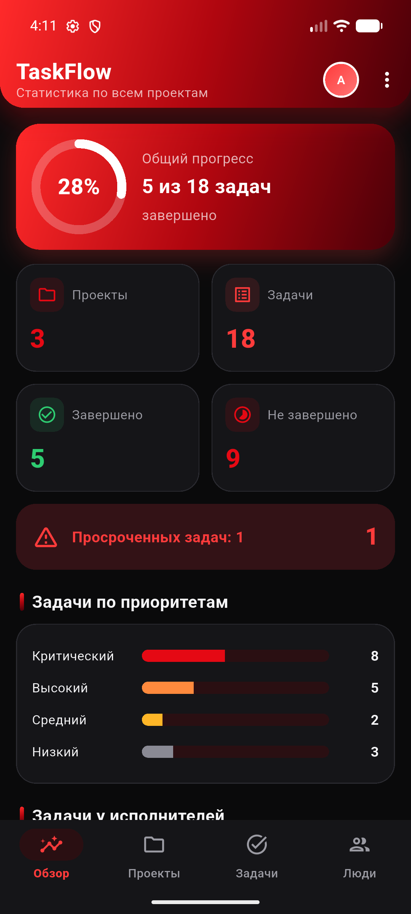
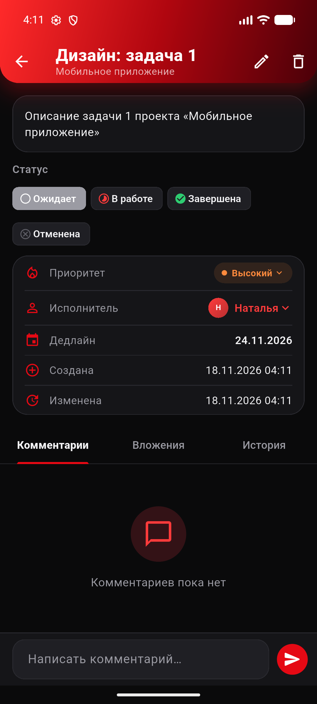
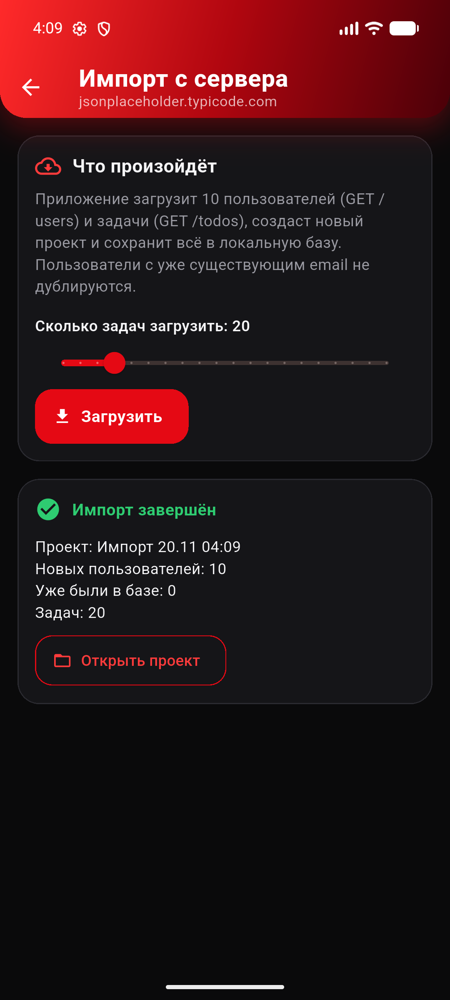

# TaskFlow — Clean Architecture (СРС 11)

Рефакторинг приложения **TaskFlow** (лабораторная № 10: проекты, задачи, SQLite/Drift)
по принципам **Clean Architecture**. Новое приложение не создавалось — переработан существующий проект.

Стек: Flutter · **flutter_bloc (Cubit)** · **get_it** (DI) · **fpdart** (`Either<Failure, T>`) ·
Drift/SQLite · Dio (сервер) · SharedPreferences. Тема: чёрный фон и красные акценты.

## Запуск

```bash
flutter pub get
dart run build_runner build
flutter run
flutter test
```

## Структура

```
lib/
├── components/           общие виджеты (карточка задачи, аватар, пустое состояние…)
├── constants/            тема и цвета (app_theme.dart)
├── models/               DTO сервера (RemoteUserModel, RemoteTodoModel)
├── core/
│   ├── rest_client/      единый HTTP-клиент на Dio, ошибки Dio → исключения Data
│   ├── database/         таблицы Drift и миграции SQLite
│   ├── error/            Failure, исключения Data Layer, ErrorHandler
│   ├── usecase/          базовые UseCase / StreamUseCase
│   └── di/               GetIt: configureDependencies()
├── src/
│   ├── data/
│   │   ├── datasources/  Local (SQLite) и Remote (сервер) источники данных
│   │   ├── mapper/       строки БД → сущности Domain
│   │   └── repositories/ реализации репозиториев (…RepositoryImpl)
│   ├── domain/
│   │   ├── entities/     User, Project, Task, Comment, HistoryEntry…
│   │   ├── repositories/ абстрактные репозитории (interface)
│   │   └── usecases/     бизнес-действия + валидация
│   └── presentation/
│       ├── pages/        экраны
│       ├── widgets/      список задач, выбор пользователя, ViewStateView
│       └── bloc/         Cubit-ы и состояния
└── main.dart
```

**Направление зависимостей — внутрь:** `presentation → domain ← data`.
Domain не знает ни о Flutter, ни о Drift, ни о Dio — это проверяют тесты 30–31.

```
Page ──► Cubit ──► UseCase ──► Repository (abstract, Domain)
                                     ▲
                       RepositoryImpl (Data) ──► DataSource ──► SQLite / сервер
```

## Domain Layer

Для каждой функциональности: **Entity → абстрактный Repository → UseCase**.
Вся бизнес-логика перенесена из репозиториев в UseCase-ы, например:

```dart
class CreateUserUseCase implements UseCase<int, ({String name, String email})> {
  Future<Either<Failure, int>> call(p) => eitherDo(($) async {
    final name = await $(Validators.text(p.name, 'Имя'));
    final email = await $(Validators.email(p.email));
    if (await $(_repo.emailExists(email))) fail(const DuplicateEmailFailure());
    return $(_repo.createUser(name: name, email: email));
  });
}
```

Правила в Domain: уникальный email; нельзя удалить пользователя с незавершёнными задачами;
исполнитель — только участник проекта; не больше 3 задач на один дедлайн; комментарий удаляет
только автор; нельзя создать задачу без проекта; Undo статуса.

## Data Layer

- **DataSource**: 8 локальных (SQLite через Drift) + `ImportRemoteDataSource` (сервер через RestClient).
- **DTO/Models**: строки Drift (`UserRow`, `TaskRow`…) и модели API (`RemoteUserModel`, `RemoteTodoModel`).
- **Mapper**: `row.toEntity()` — в Presentation попадают только сущности Domain.
- **RepositoryImpl**: вызывает DataSource и через `ErrorHandler.guard` превращает исключения в `Failure`.
- Транзакции (задача + история, переназначение, Undo) остаются в DataSource.

## Обработка ошибок (централизованно)

| Ситуация | Исключение Data | Failure |
|---|---|---|
| Нет интернета, таймаут | `NetworkException` | `NetworkFailure` |
| HTTP 500 | `ServerException` | `ServerFailure` |
| HTTP 401 | `UnauthorizedException` | `UnauthorizedFailure` |
| HTTP 400 | `BadRequestException` | `ValidationFailure` |
| Некорректный JSON | `ParseException` | `ServerFailure` |
| Ошибка SQLite | `SqliteException` | `DatabaseFailure` / `ValidationFailure` |
| Нарушение бизнес-правила | — | подвиды `ValidationFailure` |
| Пустой результат | — | состояние **Empty** |
| Всё остальное | — | `UnknownFailure` |

`RestClient` переводит ошибки Dio в исключения Data Layer, `ErrorHandler` переводит их в `Failure`.
Пользователь видит только понятный текст (`failure.message`), технические детали пишутся в лог.

## Presentation Layer

- Экраны не делают запросов и не содержат бизнес-логики: только `Cubit`.
- Состояния `ViewInitial / ViewLoading / ViewLoaded / ViewEmpty / ViewError` + единый виджет `ViewStateView` с кнопкой **«Повторить»**.
- Без лишних запросов: поиск с debounce 300 мс, защита от повторной подгрузки страницы и от двойного нажатия «Сохранить» / «Загрузить».

## Dependency Injection (GetIt)

`core/di/injection.dart` → `configureDependencies()`. Порядок регистрации:
**внешние сервисы → DataSource → Repository → UseCase → Cubit**.
Экраны получают Cubit через `getIt<…>()`, Cubit-ы получают только UseCase-ы.
Тесты используют тот же DI, подменяя базу (SQLite в памяти) и сервер (поддельный адаптер Dio).

## Новая функция: «Импорт с сервера»

Меню ⋮ → **Импорт с сервера**. Загружает пользователей (`GET /users`) и задачи (`GET /todos`)
с JSONPlaceholder, создаёт новый проект и сохраняет всё в SQLite одной транзакцией
(пользователи с существующим email не дублируются).

Сделано по Clean Architecture: `ImportPage → ImportCubit → ImportFromServerUseCase →
ImportRepository → ImportRemoteDataSource + ImportLocalDataSource`.
Состояния: Initial, Loading, Success, **Empty**, **Error** с кнопкой
**повторной отправки неудачного запроса**.

## Тесты — 32, все проходят

| Файл | Что проверяет |
|---|---|
| `domain_test.dart` (1–18) | правила UseCase-ов: email, удаление, участники, транзакция, Undo, лимит, корзина, комментарии, поиск/фильтры/пагинация, статистика |
| `import_test.dart` (19–29) | импорт, NetworkFailure, 500, 401, 400, плохой JSON, Empty, Cubit: Loading→Success, повтор, защита от двойного запроса |
| `architecture_test.dart` (30–31) | Domain без Flutter/Drift/Dio; Presentation без базы и Dio |
| `migration_test.dart` | миграция БД v1 → v2 |

## Скриншоты

| Обзор | Задачи | Задача |
|---|---|---|
|  |  |  |

| Импорт: успех | Импорт: нет интернета |
|---|---|
|  |  |
