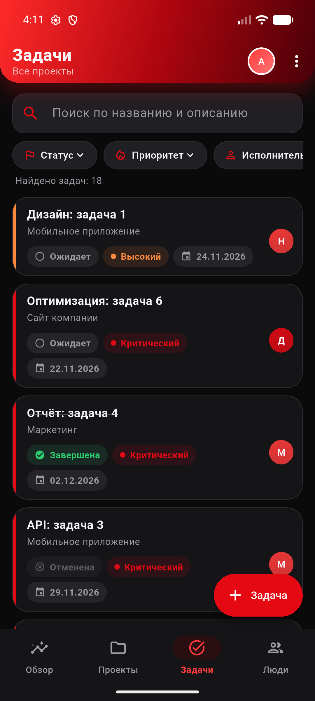
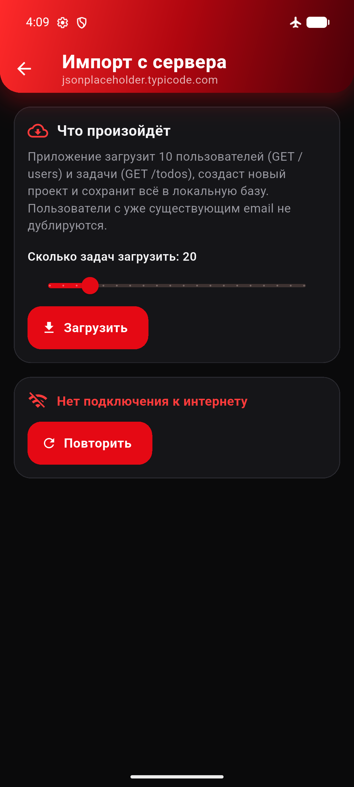

# TaskFlow — Clean Architecture (СРС 11)

Рефакторинг приложения **TaskFlow** (лабораторная № 10: проекты, задачи, SQLite/Drift)
по принципам **Clean Architecture**. Новое приложение не создавалось — переработан существующий проект.

Стек: Flutter · **flutter_bloc (Cubit)** · **get_it** (DI) · **fpdart** (`Either<Failure, T>`) ·
Drift/SQLite · Dio (сервер) · SharedPreferences. Тема: чёрный фон и красные акценты.

## Запуск

```bash
flutter pub get
dart run build_runner build
flutter run
flutter test
```

## Структура: каждая фича — в своей папке

Проект организован **по фичам (feature-first)**: всё, что относится к одному разделу
приложения (экран, его Cubit, UseCase-ы, репозиторий, источник данных), лежит в одной папке
`lib/src/<фича>/`, и внутри неё — три слоя Clean Architecture.

```
lib/
├── components/              общие виджеты (аватар, пустое состояние, ViewStateView…)
├── constants/               тема и цвета (app_theme.dart)
├── models/                  общие enum-ы (статусы, приоритеты, роли)
├── core/                    общее ядро для всех фич
│   ├── rest_client/         единый HTTP-клиент (Dio) → исключения Data
│   ├── database/            таблицы Drift и миграции SQLite
│   ├── error/               Failure, исключения, ErrorHandler
│   ├── usecase/             базовые UseCase / StreamUseCase
│   ├── bloc/                базовый WatchCubit и состояния ViewState
│   ├── validation/          правила проверки ввода
│   └── di/injection.dart    configureDependencies() — вызывает регистрацию каждой фичи
├── src/
│   ├── home/                главный экран, приветствие, текущий пользователь, демо-данные
│   ├── dashboard/           статистика
│   ├── projects/            проекты и участники
│   ├── tasks/               задачи, история, комментарии, вложения
│   ├── users/               пользователи
│   ├── trash/               корзина (soft delete)
│   ├── performance/         1000/100/10000 записей и сравнение индексов
│   └── server_import/       НОВАЯ ФУНКЦИЯ: импорт с сервера
└── main.dart
```

Каждая фича устроена одинаково (пример — `src/home/`):

```
src/home/
├── data/
│   ├── datasources/         session_local_data_source.dart, demo_seed_local_data_source.dart
│   └── repositories/        session_repository_impl.dart, demo_seed_repository_impl.dart
├── domain/
│   ├── repositories/        session_repository.dart, demo_seed_repository.dart (abstract)
│   └── usecases/            session_usecases.dart, seed_demo_data_usecase.dart
├── presentation/
│   ├── bloc/                current_user_cubit.dart, welcome_cubit.dart
│   └── pages/               home_page.dart, welcome_page.dart
└── home_di.dart             регистрация зависимостей фичи в GetIt
```

| Фича | data | domain | presentation |
|---|---|---|---|
| home | сессия, демо-данные | Session/DemoSeed Repository, UseCase-ы | HomePage, WelcomePage, CurrentUserCubit, WelcomeCubit |
| dashboard | SQL-статистика | DashboardStats, StatsRepository, WatchDashboard | DashboardPage, DashboardCubit |
| projects | проекты, участники | Project, ProjectRepository, 12 UseCase-ов | ProjectsPage, ProjectDetailPage, 3 Cubit-а |
| tasks | задачи, история, комментарии | Task, Comment, 2 репозитория, 18 UseCase-ов | TasksPage, TaskDetailPage, TaskFormPage, 4 Cubit-а |
| users | пользователи | User, UserRepository, 6 UseCase-ов | UsersPage, UserDetailPage, UserPicker, 3 Cubit-а |
| trash | удалённые задачи | TrashRepository, 4 UseCase-а | TrashPage, TrashCubit |
| performance | генерация, бенчмарк | BenchmarkResult, PerformanceRepository | PerformancePage, PerformanceCubit |
| server_import | Remote + Local DataSource, DTO | ImportResult, ImportRepository | ImportPage, ImportCubit |

**Направление зависимостей — внутрь:** `presentation → domain ← data` внутри каждой фичи.
Фичи могут использовать **domain** друг друга (например, задачам нужен `ProjectRepository`),
но никогда — чужие `data`. Это проверяют тесты 30–33.

```
Page ──► Cubit ──► UseCase ──► Repository (abstract, domain)
                                     ▲
                       RepositoryImpl (data) ──► DataSource ──► SQLite / сервер
```

## Domain Layer

Для каждой функциональности: **Entity → абстрактный Repository → UseCase**.
Вся бизнес-логика перенесена из репозиториев в UseCase-ы, например:

```dart
class CreateUserUseCase implements UseCase<int, ({String name, String email})> {
  Future<Either<Failure, int>> call(p) => eitherDo(($) async {
    final name = await $(Validators.text(p.name, 'Имя'));
    final email = await $(Validators.email(p.email));
    if (await $(_repo.emailExists(email))) fail(const DuplicateEmailFailure());
    return $(_repo.createUser(name: name, email: email));
  });
}
```

Правила в Domain: уникальный email; нельзя удалить пользователя с незавершёнными задачами;
исполнитель — только участник проекта; не больше 3 задач на один дедлайн; комментарий удаляет
только автор; нельзя создать задачу без проекта; Undo статуса.

## Data Layer

- **DataSource**: 8 локальных (SQLite через Drift) + `ImportRemoteDataSource` (сервер через RestClient).
- **DTO/Models**: строки Drift (`UserRow`, `TaskRow`…) и модели API (`RemoteUserModel`, `RemoteTodoModel`).
- **Mapper**: `row.toEntity()` — в Presentation попадают только сущности Domain.
- **RepositoryImpl**: вызывает DataSource и через `ErrorHandler.guard` превращает исключения в `Failure`.
- Транзакции (задача + история, переназначение, Undo) остаются в DataSource.

## Обработка ошибок (централизованно)

| Ситуация | Исключение Data | Failure |
|---|---|---|
| Нет интернета, таймаут | `NetworkException` | `NetworkFailure` |
| HTTP 500 | `ServerException` | `ServerFailure` |
| HTTP 401 | `UnauthorizedException` | `UnauthorizedFailure` |
| HTTP 400 | `BadRequestException` | `ValidationFailure` |
| Некорректный JSON | `ParseException` | `ServerFailure` |
| Ошибка SQLite | `SqliteException` | `DatabaseFailure` / `ValidationFailure` |
| Нарушение бизнес-правила | — | подвиды `ValidationFailure` |
| Пустой результат | — | состояние **Empty** |
| Всё остальное | — | `UnknownFailure` |

`RestClient` переводит ошибки Dio в исключения Data Layer, `ErrorHandler` переводит их в `Failure`.
Пользователь видит только понятный текст (`failure.message`), технические детали пишутся в лог.

## Presentation Layer

- Экраны не делают запросов и не содержат бизнес-логики: только `Cubit`.
- Состояния `ViewInitial / ViewLoading / ViewLoaded / ViewEmpty / ViewError` + единый виджет `ViewStateView` с кнопкой **«Повторить»**.
- Без лишних запросов: поиск с debounce 300 мс, защита от повторной подгрузки страницы и от двойного нажатия «Сохранить» / «Загрузить».

## Dependency Injection (GetIt)

У каждой фичи свой файл регистрации: `src/<фича>/<фича>_di.dart`
(например, `registerHomeFeature(getIt)`), где по порядку регистрируются
**DataSource → Repository → UseCase → Cubit** этой фичи.
`core/di/injection.dart` регистрирует общие сервисы (база, HTTP, настройки) и вызывает
регистрацию фич: users → projects → tasks → trash → dashboard → performance → server_import → home.
Экраны получают Cubit через `getIt<…>()`, Cubit-ы получают только UseCase-ы.
Тесты используют тот же DI, подменяя базу (SQLite в памяти) и сервер (поддельный адаптер Dio).

## Новая функция: «Импорт с сервера»

Меню ⋮ → **Импорт с сервера**. Загружает пользователей (`GET /users`) и задачи (`GET /todos`)
с JSONPlaceholder, создаёт новый проект и сохраняет всё в SQLite одной транзакцией
(пользователи с существующим email не дублируются).

Сделано по Clean Architecture: `ImportPage → ImportCubit → ImportFromServerUseCase →
ImportRepository → ImportRemoteDataSource + ImportLocalDataSource`.
Состояния: Initial, Loading, Success, **Empty**, **Error** с кнопкой
**повторной отправки неудачного запроса**.

## Тесты — 34, все проходят

| Файл | Что проверяет |
|---|---|
| `domain_test.dart` (1–18) | правила UseCase-ов: email, удаление, участники, транзакция, Undo, лимит, корзина, комментарии, поиск/фильтры/пагинация, статистика |
| `import_test.dart` (19–29) | импорт, NetworkFailure, 500, 401, 400, плохой JSON, Empty, Cubit: Loading→Success, повтор, защита от двойного запроса |
| `architecture_test.dart` (30–33) | в каждой фиче: domain без Flutter/Drift/Dio; presentation без базы и Dio; data не лезет в чужие фичи; у каждой фичи есть data/domain/presentation |
| `migration_test.dart` | миграция БД v1 → v2 |

## Скриншоты

| Обзор | Задачи | Задача |
|---|---|---|
|  |  |  |

| Импорт: успех | Импорт: нет интернета |
|---|---|
|  |  |
